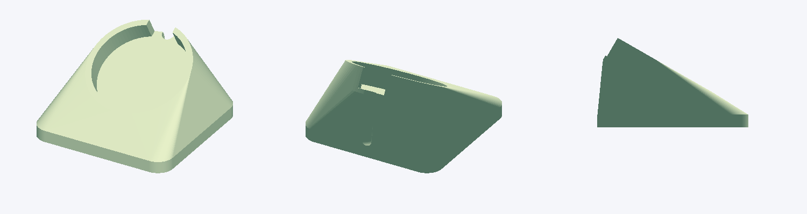

# 時間差計算（M5Stack Dial 版）

スマホアプリ「時間差計算」（`../time-calc/`）を、手のひらサイズの専用機にしたものです。
丸い画面とまわせるつまみがついた **M5Stack Dial** に入れて、3Dプリンターで作ったスタンドに立てて使います。

## 用意するもの
| もの | だいたいの値段 | メモ |
|---|---|---|
| M5Stack Dial | 5,000〜6,000円 | スイッチサイエンスなどで買えます |
| USB-C ケーブル・USB の電源 | 手持ちのもの | 電源につないで使います |
| 3Dプリンター・PLA | — | スタンドは 72×70×42mm くらい |
| すべり止めのゴム足（直径10mm）×4 | 100円くらい | なくても使えます |

## 使い方
**ホーム画面**：1つめ・2つめの開始／終了時刻、それぞれの時間差、下に2つの合計（黄色）
- つまみをまわす → 変えたい時刻をえらぶ（青い枠が動く）
- 画面を押しこむ・時刻をタップ → その時刻を変える
- 長押し → ぜんぶリセット（もう一度押しこむとリセット、まわすとやめる）

**時刻を変える画面**（スマホの時計と同じ文字盤）
- つまみをまわす、または指でなぞる → 時を合わせる（外側が00・13〜23時、内側が12・1〜11時）
- 指を離す、または押しこむ → 決定して「分」へ。分も同じように合わせて決定するとホームにもどる
- 長押し → その時刻を消す

時刻は本体に保存されるので、電源を切っても残ります。1分さわらないと画面が暗くなり、さわると明るくもどります。

## プログラムの書きこみ
### Arduino IDE を使う場合
1. 「ボードマネージャ」で **M5Stack** を入れ、ボードは **M5Dial** をえらぶ
2. 「ライブラリマネージャ」で **M5Dial**（M5Unified・M5GFX も一緒に入る）を入れる
3. `src/main.cpp` の中身を新しいスケッチに貼って、書きこむ

### PlatformIO を使う場合
このフォルダで `pio run -t upload`

### 動かしてみて合わないとき
`src/main.cpp` の上のほうの数字を変えます。
- つまみ1カチッで2つ以上動く・動きがにぶい → `ENC_STEP`（4 か 1 に）
- まわす向きが逆 → `ENC_DIR` を `-1` に
- カチッという音がいらない → `CLICK_SOUND` を `false` に

> **まだ実機では試していません。** この作業環境ではビルドの道具を入れられなかったため、ビルドも通していません。最初に書きこむときにエラーが出たら、その内容を教えてください。

## スタンドの印刷
- `case/stand.stl` をそのまま印刷します（底面を下に。サポートなし。PLA・0.2mm・充填20%くらい）
- 大きさを変えたいときは `case/stand.scad` を [OpenSCAD](https://openscad.org/) で開いて、上の数字を変えて STL を作り直します
  - **本体の直径 `body_d`**：手持ちの M5Stack Dial を測って合わせる（初めは45mm）
  - きつい・ゆるい → `clearance`
  - USB の差しこみ口が切りかきと合わない → `usb_angle`（向き）
  - かたむき → `tilt`

## 商品として売るときに確かめること
- **電波の決まり（技適）**：M5Stack Dial は Wi-Fi の部品を積んでいます。技適マークのあるもの（国内の正規店で売っているもの）を使います
- **電気の安全（PSE）**：USB の電源アダプターをいっしょに売るなら、PSE マークのあるものにします。電池を入れるなら別に調べる必要があります
- **ソフトの使用許諾**：M5Unified・M5GFX（MIT）や、画面の日本語フォント（IPAフォント由来）を使っています。説明書などに使用許諾の文を入れます
- **このリポジトリは公開されています**：売る版は、非公開のリポジトリに分けるのがおすすめです
